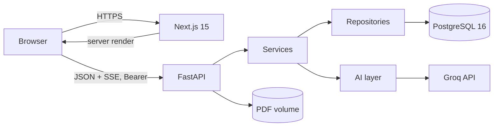
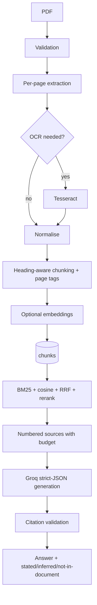
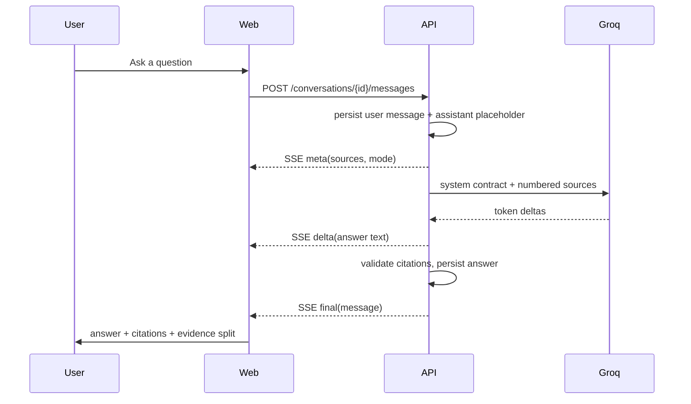
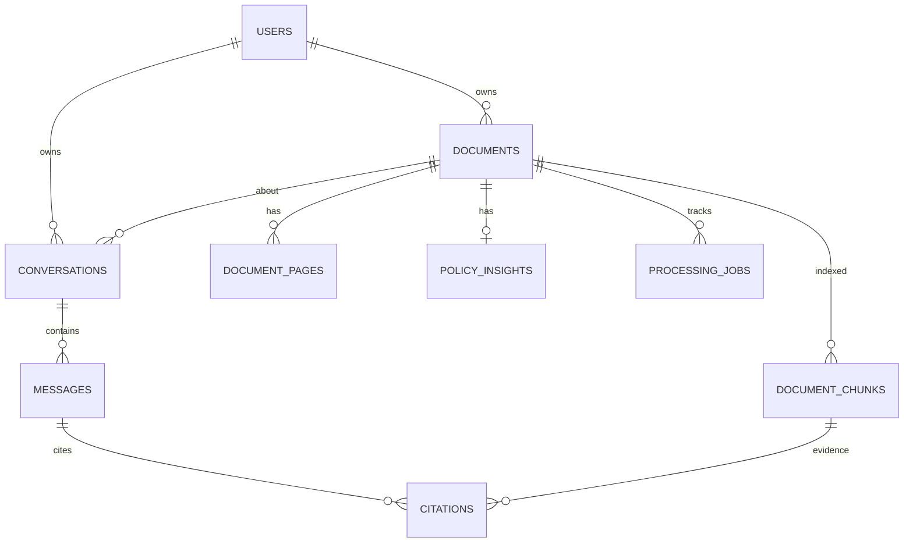
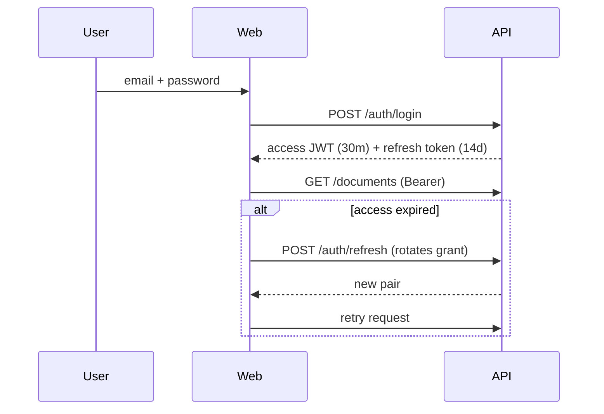

# Insurio

**AI insurance policy intelligence — answers grounded in your document, with verified citations.**

Insurio turns insurance policy PDFs into a workspace you can question. It extracts coverage,
exclusions, waiting periods, deductibles, sub-limits, claim procedures and more, then answers
questions using only the uploaded document. Every accepted quotation is validated against the
retrieved page before it is shown. When the policy is silent, Insurio says so instead of guessing.

---

## 1. Problem

An insurance policy is written for adjusters, not policyholders. Answering "is this covered?" means
finding the definitions, the coverage schedule, the exclusions, the waiting-period clause and any
sub-limit, then reconciling them. General-purpose chatbots answer from general knowledge and produce
plausible clauses that do not exist. A confident wrong answer is how a claim gets denied.

## 2. Solution

A multi-user workspace where a policy is ingested once, structured once, and then questioned with
evidence attached:

- **Page-accurate ingestion** — no page provenance is lost during chunking.
- **Hybrid retrieval** — BM25 plus semantic similarity, fused and reranked.
- **Validated citations** — quotes must exist in the retrieved source, or they are dropped.
- **Explicit uncertainty** — "stated", "interpreted" and "not in document" are separated.
- **Structured intelligence** — 20 policy fields with quote, page, confidence and missing status.
- **Deterministic comparison** — two to five policies compared on stored values, not a fresh summary.

## 3. Key features

| Area | Feature |
|---|---|
| Accounts | Register, sign in, rotating refresh tokens, password reset, session list, account deletion |
| Documents | PDF upload with validation, background processing, job progress, library, workspace, owner-only download |
| Extraction | Per-page text, heading-aware chunks, optional OCR, embeddings |
| Chat | Streaming answers, citation accordions, regenerate, copy, feedback, follow-up prompts, voice input |
| Grounding | Server-side citation validation, insufficient-evidence response, evidence split, confidence |
| Insights | Grouped policy fields with source quotes, pages, confidence, missing-state and coverage chart |
| Comparison | Field-by-field matrix with per-side evidence and missing-information detection |
| Security | Argon2id, JWT + revocable refresh grants, ownership checks, rate limits, prompt-injection boundaries |
| Operations | Health/readiness, structured logs, Alembic migrations, Docker Compose, CI |

## 4. Product screenshots

The complete UI is implemented and builds successfully: landing page, authentication, dashboard,
document library, document workspace with PDF preview, policy intelligence dashboard, streaming chat,
comparison, and settings.

**No screenshots are committed.** None were captured in this build environment, and fabricated or
mockup images are deliberately not used. To capture them, run the stack locally
(`docs/LOCAL_SETUP.md`) and screenshot `/`, `/dashboard`, `/documents/{id}`, `/insights/{id}`,
`/chat/{id}` and `/compare`.

## 5. Technology stack

| Layer | Choice |
|---|---|
| Web | Next.js 15 (App Router), React 19, TypeScript, Tailwind CSS |
| UI | Lucide icons, Framer Motion (reduced-motion aware), Recharts |
| API | FastAPI, Pydantic v2, Uvicorn |
| Data | PostgreSQL 16, SQLAlchemy 2, Alembic |
| Auth | Argon2id (`pwdlib`), PyJWT, hashed rotating refresh tokens |
| PDF | PyMuPDF, optional Tesseract OCR |
| Retrieval | In-house BM25, cosine similarity, reciprocal rank fusion, heuristic reranking |
| Embeddings | fastembed (ONNX) or sentence-transformers; deterministic hashing for tests |
| LLM | Groq (`openai/gpt-oss-120b`, fallback `openai/gpt-oss-20b`) |
| Tests | pytest, Vitest, Testing Library |
| Infra | Docker, Docker Compose, GitHub Actions |

Rationale, alternatives and trade-offs: [`docs/TECH_STACK.md`](docs/TECH_STACK.md). Decisions:
[`docs/DECISIONS.md`](docs/DECISIONS.md).

## 6. Application architecture



- The browser talks to both services directly; authenticated data is fetched client-side with a
  bearer token.
- The API is layered: routes → services → repositories → models. The AI layer has no database
  imports.
- Ingestion is a background task that writes pages, chunks, insights and job state.
- Chat is a Server-Sent Event stream produced by a generator with its own database session.

Full detail: [`docs/ARCHITECTURE.md`](docs/ARCHITECTURE.md), [`docs/SYSTEM_DESIGN.md`](docs/SYSTEM_DESIGN.md).

## 7. Backend architecture

```
backend/app/
  main.py            factory, middleware, routers
  core/              config, security, logging, errors, rate limit
  api/routes/        auth, documents, chat, comparisons, meta, health
  api/deps.py        current user, owned document, owned conversation
  schemas/           request/response contracts
  services/          auth, documents, pdf, storage, insights, comparison,
                     conversations, answering
  repositories/      users, documents, conversations, policies
  models/            users/sessions, documents/chunks/jobs, conversations,
                     insights/comparisons
  ai/                chunking, embeddings, retrieval, rerank, prompts,
                     citations, pipeline, extraction, llm
  db/                engine, session, base
```

## 8. RAG architecture



Retrieval mode is reported honestly (`hybrid`, `bm25`, `none`). The model output is a single JSON
object; only the `answer_markdown` field is streamed, and citations are trusted only after the
complete object is parsed and validated. Detail: [`docs/RAG_PIPELINE.md`](docs/RAG_PIPELINE.md).

### AI question-answering workflow



## 9. Database

PostgreSQL 16. Twelve tables covering users, sessions, password resets, documents, pages, chunks,
jobs, insights, conversations, messages, citations, feedback and comparisons. UUID primary keys,
foreign keys with cascades, status checks, and indexes for every ownership query.



Full ER diagram, columns, indexes and migration workflow: [`docs/DATABASE.md`](docs/DATABASE.md).

## 10. Authentication and authorization



Authorization is enforced in repositories with `user_id` in every document-scoped predicate. Another
user's resource returns 404. Detail: [`docs/AUTH.md`](docs/AUTH.md).

## 11. Security

- Argon2id password hashing; identical login errors for unknown email and wrong password.
- Refresh tokens are stored only as SHA-256 digests, rotate on use, and are revocable.
- Uploads are validated by magic bytes, size, encryption and page count; storage keys are server
  UUIDs and paths are containment-checked.
- Retrieved text is escaped, delimited, and explicitly untrusted. Instruction-like content is flagged.
- Rate limits on auth, chat and upload; security headers on both services; strict CORS allowlist.
- No raw HTML rendering; model output cannot inject markup.
- Production refuses to start with the development secret.

Model, gaps and accepted risks: [`docs/SECURITY.md`](docs/SECURITY.md).

## 12. Local installation

Prerequisites: Python 3.11–3.12, Node 20.9+, PostgreSQL 16 (or Docker for the database only).

```bash
git clone https://github.com/teja05-45/Insurio.git
cd Insurio

# Backend
cd backend
python -m venv .venv
source .venv/bin/activate        # Windows: .\.venv\Scripts\activate
pip install -r requirements-dev.txt
cp ../.env.example .env          # edit DATABASE_URL and SECRET_KEY
alembic upgrade head
uvicorn app.main:app --reload
```

```bash
# Frontend (new terminal)
cd frontend
npm ci
cp .env.local.example .env.local
npm run dev
```

Open `http://localhost:3000`, register, upload a policy.

Environment variables are documented in [`.env.example`](.env.example). Mandatory in production:
`SECRET_KEY`, `DATABASE_URL`, `CORS_ORIGINS`, and `NEXT_PUBLIC_API_BASE_URL` at build time.
`GROQ_API_KEY` is required only for chat.

## 13. Database creation

Local PostgreSQL:

```bash
psql -U postgres -c "CREATE ROLE insurio LOGIN PASSWORD 'insurio';"
psql -U postgres -c "CREATE DATABASE insurio OWNER insurio;"
cd backend && alembic upgrade head
```

Using Docker only for the database:

```bash
docker compose up -d db
cd backend && alembic upgrade head
```

Migrations are the only source of schema truth. The API container applies them on startup.

## 14. Docker

```bash
cp .env.example .env          # optional local defaults
docker compose up --build -d
docker compose ps
docker compose logs -f api
```

Services: PostgreSQL 16, the API (port 8000), the web app (port 3000). Volumes persist the database
and uploaded PDFs. Health checks gate startup order.

```bash
curl http://localhost:8000/health/ready
docker compose exec db psql -U insurio -d insurio
```

Full guide: [`docs/DOCKER_SETUP.md`](docs/DOCKER_SETUP.md).

## 15. Running tests

```bash
cd backend
ruff check app tests
python -m pytest -q              # full suite: 55 tests
python -m pytest -q -m unit      # 22 fast unit tests
python -m pytest -q -m integration  # 33 API tests

cd ../frontend
npm run typecheck
npm run test
npm run build
```

Run backend commands from `backend/`. `backend/pyproject.toml` sets `pythonpath = ["."]`, so both
`pytest` and `python -m pytest` import `app` deterministically. The backend suite is offline: SQLite,
hashing embeddings, injected fake LLM. No Groq calls are made.

GitHub Actions (`.github/workflows/ci.yml`) runs backend lint, backend unit tests, backend integration
tests, frontend typecheck/tests/build, both Docker image builds and `docker compose config`, with the
Docker jobs gated on their prerequisites. Actual results from this environment are in
[`docs/TEST_EXECUTION_REPORT.md`](docs/TEST_EXECUTION_REPORT.md).

## 16. API

OpenAPI is served at `/docs` outside production. Every route, the error envelope and the SSE protocol
are documented in [`docs/API.md`](docs/API.md).

```bash
TOKEN=$(curl -s -X POST localhost:8000/api/v1/auth/register \
  -H 'Content-Type: application/json' \
  -d '{"email":"a@example.com","password":"StrongPass123","full_name":"A"}' \
  | python -c "import json,sys; print(json.load(sys.stdin)['access_token'])")
curl -s localhost:8000/api/v1/documents -H "Authorization: Bearer $TOKEN"
```

## 17. Expected output

`GET /health/ready`:

```json
{"status":"ok","database":"connected","version":"2.0.0"}
```

A successful ingestion ends with the document `ready`, one or more pages, and insights containing
fields with `status` of `found`, `ambiguous` or `missing`. A chat turn emits `meta`, one or more
`delta` events, then `final` with validated citations or an explicit insufficient-evidence answer.

## 18. Troubleshooting

Common failures and fixes: [`docs/TROUBLESHOOTING.md`](docs/TROUBLESHOOTING.md). Frequent cases:
database not running, CORS mismatch, missing `GROQ_API_KEY`, scanned PDF without OCR, and a build-time
`NEXT_PUBLIC_API_BASE_URL` that does not match the public API URL.

## 19. Deployment

Production requirements, an Nginx sketch for SSE, scaling considerations and pre-launch gaps:
[`docs/DEPLOYMENT.md`](docs/DEPLOYMENT.md). The stack is container-ready, but a public launch still
needs email delivery, object storage, shared rate limiting and observability.

## 20. Limitations

Documented honestly in [`docs/FINAL_AUDIT_REPORT.md`](docs/FINAL_AUDIT_REPORT.md):

- No email delivery, so reset tokens are returned only outside production.
- Account deletion removes database rows but not PDF files from the volume.
- Rate limiting is per process; uploads are local-disk only.
- No Playwright/browser E2E suite and no visual regression tests.
- No labelled AI benchmark; no accuracy percentage is claimed.
- Embeddings are JSONB with an exact per-document scan.
- OCR requires the Tesseract binary and is off by default.

## 21. Future roadmap

[`docs/ROADMAP.md`](docs/ROADMAP.md): evaluation harness, email provider, browser E2E, object storage,
Redis rate limiting, pgvector, cross-document chat, team workspaces.

## 22. Documentation index

| Document | Contents |
|---|---|
| [Audit](docs/audit/INITIAL_AUDIT.md) | Original architecture, bugs, security findings |
| [PRD](docs/PRD.md) | Problem, personas, functional requirements, acceptance criteria |
| [Tech stack](docs/TECH_STACK.md) | Choices, alternatives, trade-offs, versions |
| [Architecture](docs/ARCHITECTURE.md) | Layers and request flows |
| [System design](docs/SYSTEM_DESIGN.md) | Contracts, scaling, operations |
| [Design](docs/DESIGN.md) | Tokens, components, responsive and accessibility rules |
| [Database](docs/DATABASE.md) | ER diagram, tables, indexes, migrations |
| [API](docs/API.md) | Routes, errors, SSE, examples |
| [Auth](docs/AUTH.md) | Token model and ownership enforcement |
| [Security](docs/SECURITY.md) | Threat model and controls |
| [RAG pipeline](docs/RAG_PIPELINE.md) | Extraction, retrieval, grounding, validation |
| [AI evaluation](docs/AI_EVALUATION.md) | What is tested and what is not measured |
| [Testing](docs/TESTING.md) | Strategy, fixtures, commands |
| [Local setup](docs/LOCAL_SETUP.md) | Development environment |
| [Docker setup](docs/DOCKER_SETUP.md) | Compose operations |
| [Deployment](docs/DEPLOYMENT.md) | Production checklist |
| [Troubleshooting](docs/TROUBLESHOOTING.md) | Failure modes |
| [User guide](docs/USER_GUIDE.md) | Product walkthrough |
| [Developer guide](docs/DEVELOPER_GUIDE.md) | Conventions and extension points |
| [Decisions](docs/DECISIONS.md) | Architecture decision records |
| [Roadmap](docs/ROADMAP.md) | Planned work |
| [Changelog](docs/CHANGELOG.md) | Release history |
| [Final audit](docs/FINAL_AUDIT_REPORT.md) | Verification status |
| [Test report](docs/TEST_EXECUTION_REPORT.md) | Commands and actual results |
| [Delivery report](docs/FINAL_DELIVERY_REPORT.md) | Summary of the rebuild |

The original Streamlit prototype is preserved in [`legacy/streamlit/`](legacy/streamlit/) for
reference and is not part of the runtime.

## 23. Contributing

See [`CONTRIBUTING.md`](CONTRIBUTING.md). Conventional Commits, tests for behaviour, no secrets, and
documentation updated with contracts.

## 24. Disclaimer

Insurio is an informational tool. It does not sell insurance, adjudicate claims, or provide legal or
medical advice. Always confirm coverage with your insurer.

## 25. License

[MIT](LICENSE)
