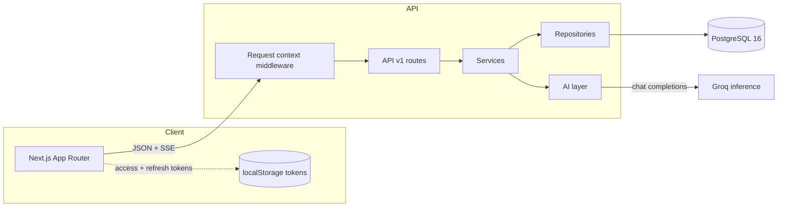
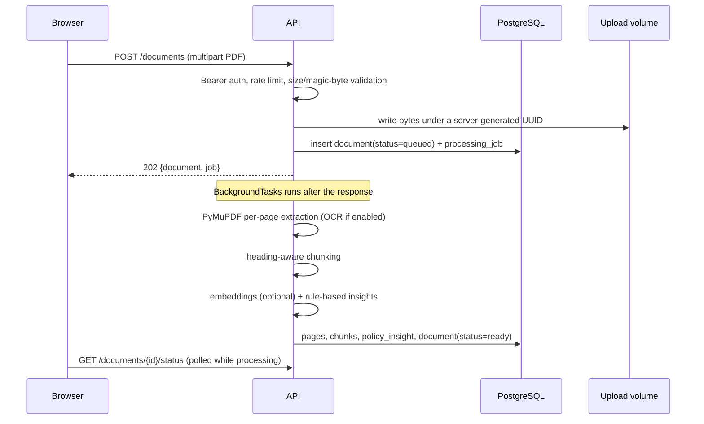
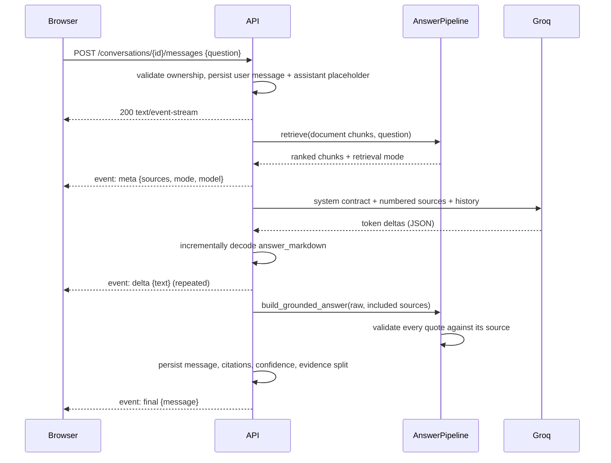

# Architecture

## 1. Shape of the system

Insurio is three deployable units plus PostgreSQL:

| Unit | Responsibility | Runtime |
|---|---|---|
| `frontend/` | Product UI, session handling, streaming rendering | Next.js 15 (App Router), Node 22 |
| `backend/` | API, auth, document ingestion, retrieval, LLM orchestration | FastAPI, Python 3.12 |
| `db` | Durable state for users, documents, chunks, conversations | PostgreSQL 16 |

```
Browser ──HTTPS/SSE──> Next.js ──fetch (Bearer)──> FastAPI ──SQL──> PostgreSQL
                                                        └──HTTPS──> Groq API
```

The browser talks to both services directly. The Next.js server renders the shell and static
pages; all authenticated data is fetched client-side with a bearer token. Streaming uses
`fetch` + a `ReadableStream` reader because `EventSource` cannot send an `Authorization` header.

## 2. High-level architecture



## 3. Backend layering

```
backend/app/
  main.py            application factory, middleware, router registration
  core/              config, security primitives, logging, errors, rate limiting
  api/               deps.py (auth + ownership) and routes/ (HTTP only)
  schemas/           Pydantic request/response contracts
  services/          business logic and orchestration
  repositories/      all SQL; one module per aggregate
  models/            SQLAlchemy 2 typed models
  ai/                provider-independent retrieval and generation
  db/                engine, session factory, declarative base
```

Rules that hold throughout the codebase:

- **Routes never query the database directly.** They resolve dependencies, call a service, and map
  to a schema.
- **Services never construct SQL.** They compose repository calls and raise `AppError` for expected
  failures.
- **The AI layer knows nothing about the database.** It operates on `PageText`, chunk-like objects,
  and plain dicts, which is why it is unit-testable without a session.
- **Every document-scoped route resolves ownership first.** `OwnedDocument` and
  `OwnedConversation` dependencies return 404 (not 403) for another user's resource.

## 4. Request flows

### 4.1 Upload and ingestion



Processing runs in-process via FastAPI `BackgroundTasks`. It opens its own session, resets prior
output so retries are idempotent, and records failures on both the document and the job row.

### 4.2 Question answering



The generator owns its database session because a streaming response outlives the request-scoped
dependency. A dropped connection leaves the answer marked `streaming`; `get_detail` settles answers
older than five minutes as `failed` so the UI never shows a permanently spinning message.

## 5. Frontend architecture

```
frontend/
  app/
    page.tsx                 landing (server component)
    login|register|forgot    public auth flows
    (app)/layout.tsx         RequireAuth + AppShell
    (app)/dashboard          usage, recent documents, recent conversations
    (app)/documents          library + upload
    (app)/documents/[id]     workspace: status, pages, PDF, actions
    (app)/insights/[id]      structured policy intelligence + chart
    (app)/chat               conversation library
    (app)/chat/[id]          streaming chat, citations, feedback
    (app)/compare            selection and field-by-field comparison
    (app)/settings           profile, security, usage, deletion
  components/                design-system primitives and feature pieces
  lib/                       API client, auth context, formatting, types
```

- All authenticated screens are client components; they fetch on mount with an explicit loading,
  empty, error, and success state.
- The API client is the only place that knows about tokens. It retries a request once after a
  refresh, with a single-flight refresh lock so parallel requests do not rotate twice.
- Markdown answers are rendered with `react-markdown` without raw HTML, so model output cannot
  inject markup.
- The PDF is fetched as a blob with the bearer token and rendered from an object URL; the API never
  exposes an unauthenticated file URL.

## 6. Failure and degradation model

| Failure | Behaviour |
|---|---|
| No `GROQ_API_KEY` | Chat returns 503 `llm_not_configured`; upload, extraction, insights, comparison and history work |
| Embedding model unavailable | Retrieval reports `bm25`; no silent pretence of semantic search |
| LLM returns non-JSON | Answer text is shown, `citation_status=unparsed` |
| Invented citation | Quote is dropped; status is `missing`/`partial` |
| Scanned PDF without OCR | Explicit `no_extractable_text` failure on the document |
| LLM outage | `llm_unavailable` mapped to 502; no provider text leaks to the client |
| Dropped stream | Placeholder healed to `failed` after five minutes |

## 7. Why this design

- **One repository per aggregate** keeps SQL reviewable and avoids N+1 surprises in routes.
- **Schema-per-boundary** (`schemas/`) makes the OpenAPI contract explicit and prevents accidental
  ORM leakage.
- **Local file storage** is correct for a single-node deployment and is isolated behind
  `services/storage.py`, so object storage is a one-module change.
- **JSONB embeddings** avoid a native extension for corpora of hundreds to low thousands of chunks;
  the retrieval interface is the seam for pgvector later.
