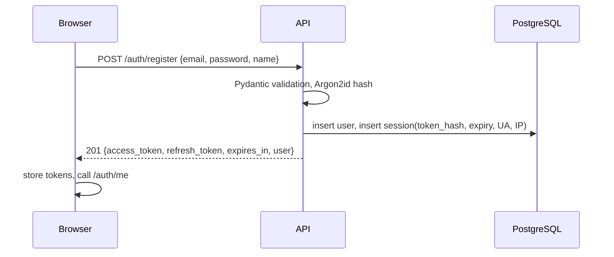
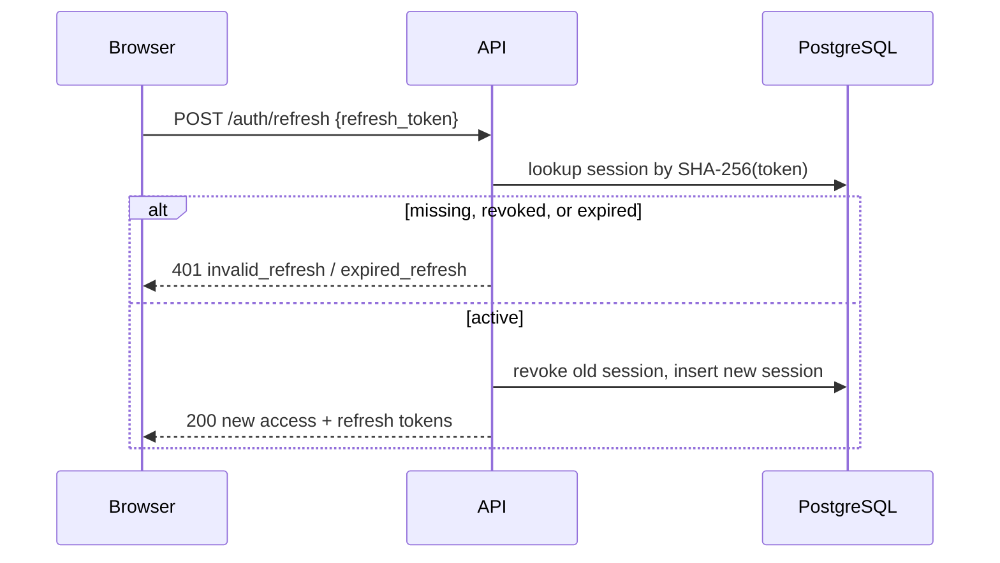
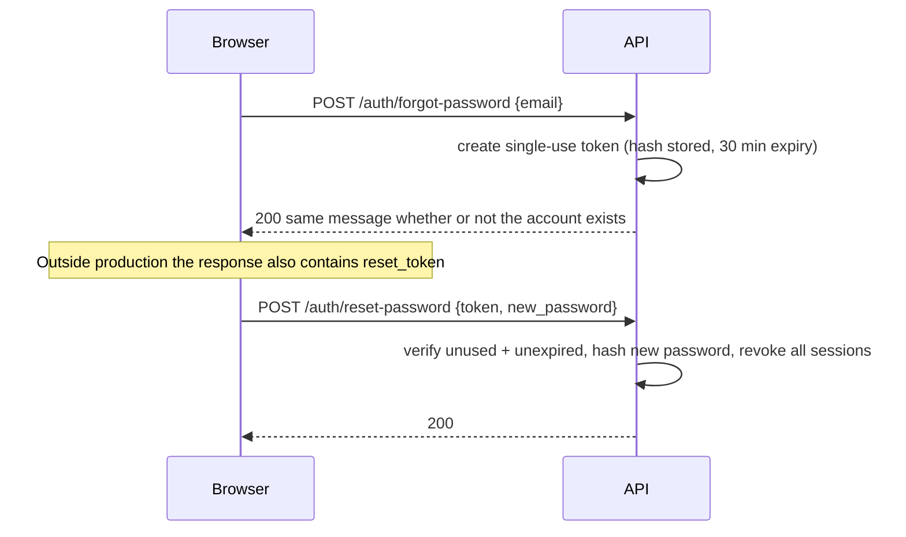

# Authentication and Authorization

## 1. Token model

| Token | Form | Lifetime | Storage |
|---|---|---|---|
| Access | JWT HS256, `typ=access`, `sub=<user id>`, `jti`, `iat`, `exp` | 30 min (5–1440 configurable) | `localStorage` on the client |
| Refresh | 64-char URL-safe random string | 14 days (1–90 configurable) | SHA-256 digest in `sessions`; raw value in `localStorage` |

Refresh tokens are revocable server-side, rotate on every use, and are never stored in plaintext.
The frontend performs a single-flight refresh: concurrent 401s share one rotation, then retry once.

## 2. Registration and login

Login returns the same `invalid_credentials` error for an unknown email and a wrong password.
Passwords must be 10–128 characters with at least one letter and one digit.

## 3. Refresh rotation

Reusing a rotated token fails, which bounds the damage of a stolen refresh token to a single
rotation.

## 4. Password reset

Email delivery is not implemented in this build. In production the raw token is never returned and
the operator must wire a mail provider (`docs/SECURITY.md` lists this as a gap).

## 5. Authorization

Authentication answers *who*; authorization answers *whether this user may touch this row*.

- `get_current_user` decodes the JWT, loads the user, and rejects inactive accounts.
- `OwnedDocument` loads `documents WHERE id = ? AND user_id = ?`; a miss returns 404.
- `OwnedConversation` does the same for conversations, so message routes inherit the check.
- Feedback resolves the message through `messages → conversations → user_id`.
- Comparisons are looked up with `user_id` in the predicate.
- File bytes are served only through the authenticated document route; the storage path is never
  exposed.

Schema-level foreign keys do not provide isolation, so every repository read for a user-facing
resource takes the owner id explicitly.

## 6. Account lifecycle

| Action | Effect |
|---|---|
| Change password | Verify current password, hash new password, revoke all refresh grants |
| Reset password | Single-use token, revoke all refresh grants |
| Update profile | Name only; email changes are unsupported |
| Delete account | Password required; cascades to documents, conversations, messages, citations, insights, comparisons, feedback |
| Sign out | Revoke the presented refresh grant and clear local tokens |

## 7. Frontend session handling

`lib/auth.tsx` bootstraps from `/auth/me` when a token exists. `RequireAuth` blocks authenticated
layouts until the check completes and redirects to `/login` on failure. A 401 on any request triggers
one refresh attempt inside `lib/api.ts`; if that fails, tokens are cleared and the next guarded
render redirects.

Access tokens in `localStorage` are an accepted trade-off for a token-based SPA. It is documented in
`docs/TECH_STACK.md` along with the httpOnly-cookie alternative.
