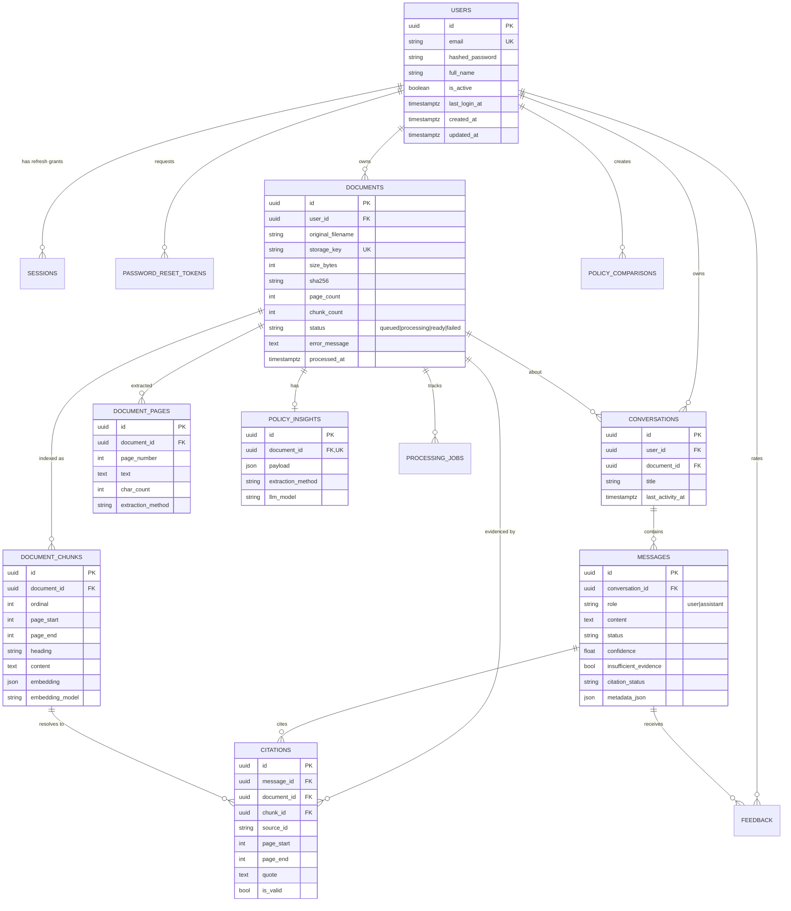

# Database

PostgreSQL 16 is the production database. SQLite is supported for tests and offline demos only.

## 1. Entity relationship diagram



## 2. Tables

| Table | Purpose | Key constraints |
|---|---|---|
| `users` | Accounts | unique email, UUID PK |
| `sessions` | Refresh grants | unique token hash, indexed `(user_id, revoked_at)` |
| `password_reset_tokens` | Single-use reset grants | unique token hash, expiry + `used_at` |
| `documents` | Upload metadata and processing state | unique `storage_key`, status CHECK, `(user_id, created_at)`, `(user_id, sha256)` |
| `document_pages` | Page-accurate extracted text | unique `(document_id, page_number)` |
| `document_chunks` | Retrieval units with provenance | unique `(document_id, ordinal)`, `(document_id, page_start)` |
| `policy_insights` | Structured extraction payload | unique `document_id` |
| `processing_jobs` | Observable ingestion state | status CHECK, `(document_id, created_at)` |
| `conversations` | Threads scoped to a document and user | indexed `(user_id, last_activity_at)` |
| `messages` | Turns with grounding metadata | role CHECK, `(conversation_id, created_at)` |
| `citations` | Validated quotes with page ranges | FKs to message, document, chunk |
| `feedback` | Helpful / not helpful votes | unique `(message_id, user_id)`, rating CHECK |
| `policy_comparisons` | Snapshot of a structured comparison | indexed `(user_id, created_at)` |

All identifiers are UUIDs generated by the application. `created_at` / `updated_at` are server
defaulted. Foreign keys that represent ownership cascade on delete, so deleting a user removes every
document, page, chunk, conversation, message, citation, insight and comparison.

## 3. Indexing notes

- Document listing is `WHERE user_id = ? ORDER BY created_at DESC`; covered by
  `ix_documents_user_created`.
- Duplicate-upload detection uses `(user_id, sha256)` before bytes are stored.
- Chunk retrieval loads all chunks for one document ordered by ordinal; the corpus is
  per-document, so this is a bounded scan.
- Conversation lists order by `last_activity_at DESC NULLS LAST` with an index on
  `(user_id, last_activity_at)`.
- Citation and message lists use `(message_id)` and `(conversation_id, created_at)` respectively.

## 4. Migrations

Alembic is the only source of schema truth.

```bash
cd backend
alembic upgrade head                                  # apply
alembic revision --autogenerate -m "add x"            # generate after model changes
alembic downgrade -1                                  # roll back one revision
alembic current                                       # show head
```

The Docker image runs `alembic upgrade head` before starting Uvicorn, so a fresh volume converges
automatically. `alembic/env.py` reads `DATABASE_URL` from application settings, not from
`alembic.ini`, which keeps one source of configuration.

## 5. Transactions

- Ingestion opens a session, marks the job `processing`, commits, then performs extraction; on
  success it commits pages, chunks, insights and the final status together.
- Regeneration deletes the previous citations and resets the assistant message in one commit before
  streaming.
- Streaming answers persist content and citations in a single commit at the end of the stream.
- Refresh-token rotation revokes the old grant and inserts the new one in the same transaction.

## 6. Data isolation

Every document-scoped query includes `user_id` in the predicate through
`repositories/documents.get_owned`. There is no route that looks up a document by id alone. The
same rule is enforced for conversations, insights (via the document) and comparisons. Foreign keys
alone do not provide isolation; the repository predicate does.
