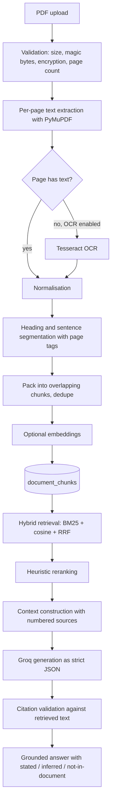

# RAG Pipeline

The pipeline is deliberately small and auditable. There is no framework between the document and
the model, because citation validation and prompt boundaries are the product.

## 1. End-to-end flow



## 2. Extraction

`services/pdf.py`

- Rejects non-PDF bytes by magic number, not extension.
- Rejects encrypted PDFs with an actionable message.
- Enforces `MAX_PDF_PAGES` and `MAX_UPLOAD_MB`.
- Extracts each page independently; a page's number is never lost.
- If a page yields fewer than 40 characters and `OCR_ENABLED=true`, renders at 200 dpi and runs
  Tesseract. Failure returns empty text rather than raising.

## 3. Chunking

`ai/chunking.py`

- Text is normalised (line endings, control characters, whitespace, repeated blank lines).
- Heading detection combines numbering (`Section 3`, `3.1`), known insurance headings, short
  all-caps lines, and colon-terminated short lines.
- Bullets stay whole; other lines split into sentences that carry `(page, heading)`.
- Chunks are packed up to 1,200 characters with an 180-character tail overlap, never across a
  heading change.
- A SHA-256 fingerprint of normalised content removes duplicates.
- Every chunk stores `page_start`, `page_end`, `heading`, and a stable ordinal.

This is what makes page-level citation possible: the retriever returns chunks, and each chunk knows
where it came from.

## 4. Retrieval

`ai/retrieval.py`

1. **BM25** over the document's chunks (k1 = 1.5, b = 0.75), with a shared stopword tokenizer.
2. **Cosine similarity** between the query embedding and stored chunk embeddings, when an embedder
   is available.
3. **Reciprocal rank fusion** of both candidate lists (`1 / (60 + rank + 1)`), normalised to the top
   fused score.
4. **Heuristic reranking** blending lexical coverage, exact phrase match, heading match, and numeric
   agreement (`0.65 * fused + 0.35 * rerank`).
5. Filtering: drop chunks that matched neither lexically nor semantically, apply `min_score`, sort,
   truncate to `top_k` (default 6, configurable 1–10 per request).

The response reports the mode actually used: `hybrid`, `bm25`, or `none`. There is no silent claim of
semantic search when embeddings are absent.

## 5. Context construction

`ai/prompts.py`

- Each source is rendered as `<source id="S1" page 4 heading="Exclusions">…</source>` with HTML
  escaping, so document text cannot close the tag or inject markup.
- Total context is capped at 14,000 characters; a source is truncated at 4,000. Sources that do not
  fit the budget are not cited because they are not included.
- History is capped at the last six messages and 2,000 characters each.
- Injection heuristics flag source text that contains instruction-like phrases, for logging and
  UI signalling. The system prompt treats all source content as data regardless.

## 6. Generation contract

The model must return one JSON object:

```json
{
  "answer_markdown": "string",
  "citations": [{ "source_id": "S1", "quote": "verbatim text" }],
  "stated": ["..."],
  "inferred": ["..."],
  "not_in_document": ["..."],
  "confidence": 0.0,
  "insufficient_evidence": false
}
```

Rules enforced in the system prompt:

1. Answer only from the supplied sources.
2. Never invent clauses, amounts, waiting periods, or quotes.
3. Set `insufficient_evidence` when the sources do not answer the question.
4. Separate stated facts, interpretation, and absent information.
5. Flag internal contradictions instead of choosing a side.
6. Cite every document-derived claim inline as `[S1]`.

Streaming uses `AnswerFieldExtractor`, a small incremental JSON decoder that emits only the
`answer_markdown` string as it arrives. Citations and flags are trusted only after the complete
object is parsed and validated — the stream cannot leak an unvalidated citation to the UI.

## 7. Citation validation

`ai/citations.py`

A citation is accepted only when all of the following hold:

- `source_id` refers to a source actually included in the prompt;
- the quote is between 6 and 600 characters;
- the quote appears in that source after case/punctuation-insensitive normalisation;
- the (source, quote) pair has not already been accepted.

Rejected citations are counted and the answer's `citation_status` becomes `partial` (some valid) or
`missing` (none valid). An unparseable model response is shown as text with status `unparsed`, never
as a cited answer.

## 8. Insufficient evidence

Two paths produce an explicit refusal:

- **No retrieved chunks**: the pipeline returns a fixed explanation without calling the LLM.
- **Model sets `insufficient_evidence`**: the answer is persisted with `citation_status =
  not_applicable` and an amber badge in the UI.

Neither path fabricates coverage. This behaviour is covered by tests in `tests/test_chat_api.py`.

## 9. Policy insights

`ai/extraction.py` runs deterministic rules first: 20 field specifications (policyholder, insurer,
policy number/type, insured members, sum insured, coverage, exclusions, waiting periods, deductible,
co-payment, room rent, sub-limits, PED, maternity, renewal, grace period, claim procedure, claim
documents, conditions).

Each field stores value, quote, page, confidence and status (`found`, `ambiguous`, `missing`).
LLM enrichment is optional and merged only if its quote is verifiable on the stated page — the model
cannot insert an unverifiable value.

## 10. Known limitations

- Benchmarking was not run against a labelled insurance corpus; `docs/AI_EVALUATION.md` describes the
  fixtures that exist and what a real evaluation would require.
- Embeddings are stored as JSON and scored with an exact scan per document. Above roughly 20k chunks
  per document this should move to pgvector.
- Reranking is heuristic, not a cross-encoder. It improves ordering but is not a learned relevance
  model.
- OCR depends on the external Tesseract binary and is disabled by default.
