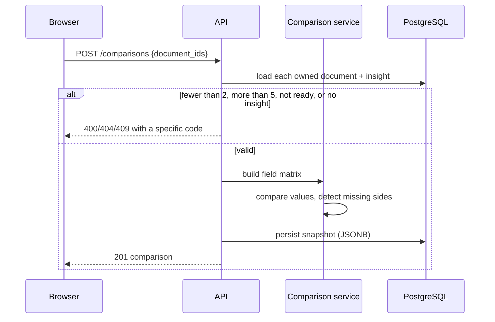

# System Design

## 1. Component contracts

| Component | Inputs | Outputs | Owns |
|---|---|---|---|
| `documents` routes | Bearer user, multipart PDF | Document + job, pages, insights | No domain logic |
| `document_service` | User, bytes | Document rows, ingestion | Validation, extraction orchestration |
| `pdf` service | Bytes, settings | Page text with method | PyMuPDF, OCR fallback |
| `chunking` | Pages | Chunk drafts | Boundaries, provenance, dedupe |
| `retrieval` | Chunks, query | Ranked chunks + mode | BM25, cosine, RRF, rerank |
| `AnswerPipeline` | Chunks, question, history | Streamed raw output | Prompt assembly, context budget |
| `citations` | Raw citations, sources | Accepted + invalid count | Verbatim validation |
| `answering` | Conversation, question | SSE frames, persisted answer | Stream lifecycle, persistence |
| `conversation_service` | Conversation, user | Messages, exchange | Ownership-aware reads, regeneration |
| `insight_service` | Document | Policy insight | Rule/LLM extraction merge |
| `comparison` service | Documents, insights | Comparison payload | Field matrix, missing detection |

Each boundary has a single reason to change. For example, swapping Groq for another provider touches
`ai/llm.py` only; changing chunk size touches `ai/chunking.py` only.

## 2. Comparison flow



Comparison is deterministic: it reads stored insight fields, not a fresh LLM summary. Each cell
carries the original value, quote, page and confidence. A field absent from every policy is omitted;
a field absent from one policy is marked `missing_in`, which is often the most important finding.

## 3. Ingestion state machine

```
queued ──> processing ──> ready
                 └──────> failed
```

- The upload response is 202 and includes the job.
- The workspace polls `/status` every 2.5 s while the document is `queued` or `processing`.
- A job records progress (10/40/70/100) and a human-readable detail.
- Failures write both `documents.error_message` and `processing_jobs.error_message`; the UI shows the
  document error verbatim.
- Re-running ingestion deletes prior pages/chunks first, so a retry cannot duplicate evidence.

## 4. Performance

| Concern | Current approach | Measured? |
|---|---|---|
| Upload latency | Returns after validation + file write; parsing is background | Not benchmarked |
| Retrieval | Exact BM25 + cosine over one document's chunks | Not benchmarked |
| Chat latency | Streamed deltas; latency stored per message | Observed in tests, not benchmarked |
| Embedding cost | Model loaded once per process (`lru_cache`), optional | Not benchmarked |
| Bundle size | Static pages ~103 kB shared JS; insights page 220 kB (Recharts) | Next build output |
| Database | Indexed ownership and activity queries; no N+1 in list endpoints | Reviewed, not profiled |

No performance claims are made beyond what was observed. A benchmark harness is future work.

## 5. Scaling path

1. **API replicas** — stateless apart from local uploads. Move `UPLOAD_DIR` to object storage and the
   rate limiter to Redis before running more than one replica.
2. **Ingestion workers** — replace `BackgroundTasks` with a queue (Celery/RQ/Arq) when documents grow
   beyond second-scale processing. The `processing_jobs` table already models the work.
3. **Vector search** — move embeddings to pgvector once a single document exceeds roughly 20k chunks
   or cross-document retrieval is required. The retrieval interface is isolated.
4. **Read replicas** — list and workspace reads can move to a replica; writes stay primary.
5. **Observability** — structured logs exist; add metrics (upload duration, retrieval hits, LLM
   latency, citation rejection rate) and tracing before production traffic.

## 6. Operational behaviour

- `/health/live` never touches the database (safe for liveness probes).
- `/health/ready` executes `SELECT 1` and returns 503 with a reason when the database is unavailable.
- Compose starts PostgreSQL with `pg_isready`, then the API (migrations, then Uvicorn), then the web
  app, each gated on the previous health check.
- Logs are single-line JSON on stdout with request ids, method, path, status and duration.
- Background failures are logged with stack traces but never returned to the client.

## 7. Testing seams

- `LLM` is a protocol; tests inject `FakeLLM` and assert streaming and validation behaviour.
- `Embedder` is a protocol; tests inject the deterministic hashing embedder.
- The database URL and upload directory come from settings, so tests use SQLite and a temp directory.
- Rate limiting is disabled when `APP_ENV=test`.
